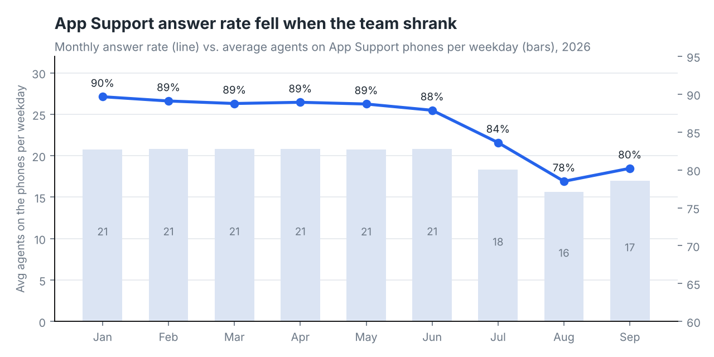
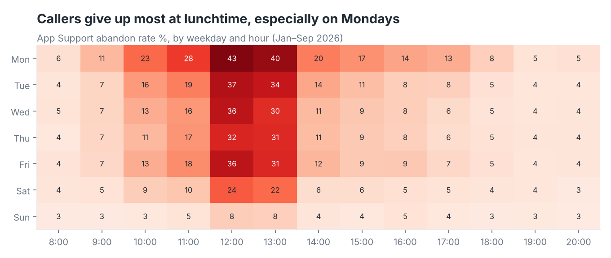
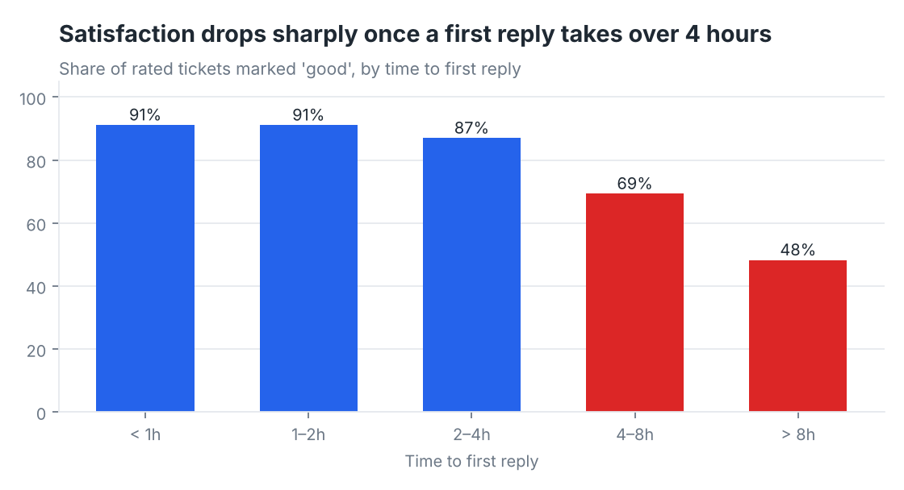

# Contact Center Performance: calls and tickets in one view

**Tools:** SQL (BigQuery) · Looker Studio · Google Sheets
**Data:** 713K offered phone calls (hourly queue stats), 10K agent-days, 58K helpdesk tickets · Jan–Sep 2026
**Note:** Synthetic data. I built the original version of this dashboard at work, for a payments company's support teams. To share it publicly, I rebuilt it here on generated data for a fictional digital wallet, "Northwind Pay". The structure matches the real exports, but every name and number is made up.

---

## The problem

The support managers had two disconnected data sources:
- phone stats in the call-center system's exports
- ticket stats in the helpdesk

Every week someone copied numbers from both into a spreadsheet. By the time the report was ready, it described last week. Nobody could answer simple questions quickly:
- Which queue is losing callers, and at what time of day?
- Is the team big enough?
- Do slow first replies on tickets actually hurt satisfaction?

## What I built

1. **Cleaning layer (SQL views).** The raw exports had four problems. A few days were exported twice. New hires appeared under temporary phone-system IDs that weren't in the staff list. Ticket statuses came in mixed casing. Some tickets were "solved" before they were created. The views fix or flag each of these, so every chart uses the same clean numbers ([`sql/01_clean_views.sql`](sql/01_clean_views.sql)).
2. **KPI queries.** Answer rate, abandon rate, 20-second service level, average speed of answer, calls per logged-in hour, occupancy, first reply time, resolution time and CSAT ([`sql/`](sql)).
3. **A 4-page Looker Studio dashboard.** Calls overview, agent performance, tickets overview, and an insights page. Managers filter by date, queue, team and agent instead of asking for a new report.

| Data issue found | Rows affected | How it's handled |
|---|---|---|
| Same day exported twice | 68 agent-day rows | Removed with `SELECT DISTINCT` |
| Temporary phone-system IDs not in the staff list | 154 agent-day rows | Labelled "Unmapped" and kept out of agent rankings |
| Ticket status in mixed casing (`solved` vs `Solved`) | 1,739 tickets | Standardised with `INITCAP` |
| `solved_at` earlier than `created_at` | 40 tickets | Excluded from resolution-time averages |

## What the data showed

**1. The summer drop in service was a staffing problem, not a demand problem.**
Call volume barely moved, but App Support's answer rate fell from **89.7% in January to 78.5% in August**. Average agents on the phones each weekday went from 21 to 16 after six people left in July. On weekdays with 20+ agents on the phones, the average answer rate was **87.6%**. With 16–17 agents it was **76.6%**.



**2. Lunchtime is where callers give up.**
12:00–14:00 brings 19% of App Support's calls but **44% of its abandoned calls**. The abandon rate in that window is **31.7%**, against 9.7% for the rest of the day. On Mondays at noon it reaches **42.5%**.



**3. Ticket satisfaction holds up until the 4-hour mark, then falls fast.**
CSAT is about **91%** when the first reply comes within 2 hours and **87%** within 4 hours. It drops to **69%** at 4–8 hours and **48%** after 8 hours. In August only **53%** of tickets got a first reply within 4 hours, down from about 85% in the first half of the year. That month CSAT dropped to **74.9%**.



## What I'd recommend

- **Stagger lunch breaks** so the 12:00–14:00 floor isn't 30% short, starting with Mondays. As a rough estimate, bringing lunchtime abandons down to the rest-of-day rate would have saved about **19,500 calls** over these nine months.
- **Treat 18 agents on the phones as the minimum** for App Support on weekdays. Backfill before people leave, not after.
- **Set a 4-hour first-reply target for tickets** and alert team leads when the share of tickets still waiting past 3 hours rises.

## Repo contents

```
data/            synthetic CSVs (agents, calls_queue_hourly, calls_agent_daily, tickets)
sql/             BigQuery SQL: cleaning views + KPI and analysis queries
scripts/         generate_data.py (how the synthetic data was made), make_charts.py
images/          charts used in this README
BUILD_GUIDE.md   step-by-step: load into BigQuery, build the Looker Studio report
```

## Data dictionary

| Table | One row per | Key columns |
|---|---|---|
| `agents` | agent | agent_id, agent_name, team, hire_date, leave_date |
| `calls_queue_hourly` | queue × day × hour | offered, answered, abandoned, answered_within_20s, total_answer_delay_s, max_answer_delay_s |
| `calls_agent_daily` | agent × day × queue | logged_in_s, talk_s, not_ready_s, break_s, presented, answered, short_calls, transfers_out |
| `tickets` | ticket | created_at, first_reply_at, solved_at, status, entity (team), category, channel, assignee_id, satisfaction, reopened |
