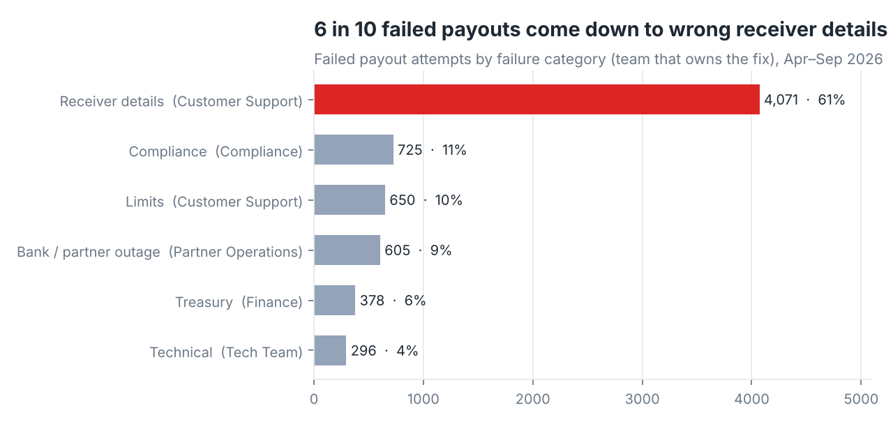
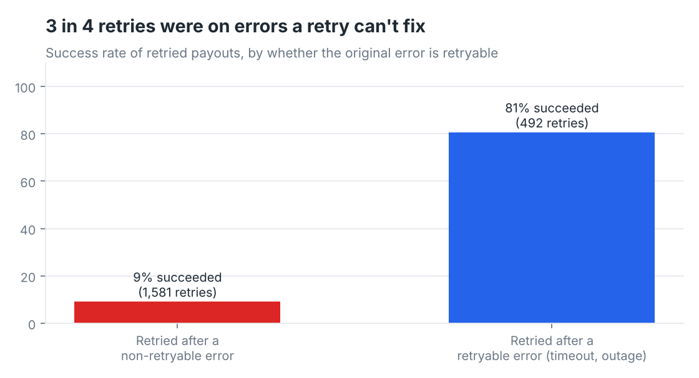
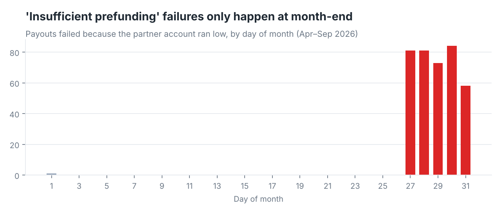

# Cross-border Payout Failure Monitoring

**Tools:** Power BI (Power Query, DAX, star schema) · Excel/CSV sources
**Data:** 82K payout attempts to 10 countries and 60 receiving banks/wallets · Apr–Sep 2026
**Note:** Synthetic data. At work I built a monitoring dashboard for international payouts sent through a payout-network partner. This is a rebuild on generated data for a fictional wallet, "Northwind Pay". Bank names are codes ("EG Bank 01"), so nothing points to a real institution.

---

## The problem

When a payout to Ethiopia or the Philippines failed, the partner's export said why only in a raw response code and a free-text message. The same error showed up as "Invalid Account Number", "INVALID_ACCOUNT" or "acct invalid – check account no". Bank names were spelled six different ways. As a result:
- nobody could say which failures were the customer's fault, which were a bank outage, and which were ours
- operations staff retried failed payouts by hand, whatever the error
- when a receiving bank went down, the team found out from customer complaints

## What I built

1. **An error taxonomy.** Every response code maps to:
   - a plain-English message
   - a **failure category**
   - the **team that owns the fix**
   - a **severity**
   - whether to **escalate**
   - whether a **retry can work**

   The taxonomy turns a list of error codes into a to-do list per team ([`data/error_taxonomy.csv`](data/error_taxonomy.csv)).
2. **Power Query cleaning.** The cleaning steps:
   - remove the 85 rows the partner re-sent
   - standardise status values
   - map 360 raw bank-name spellings to 60 banks
   - convert local currency to USD using that month's FX rate
   - link every retry back to its original attempt
3. **A star schema in Power BI.**
   - Fact table: `FactPayouts`
   - Dimension tables: `DimDate`, `DimBank`, `DimCountry`, `DimErrorCode`
   - About 20 DAX measures: success rates, final success after retries, outage rate, an incident flag, and wasted retries.
4. **Five report pages.** Executive overview, why payouts fail, banks & corridors, incident monitor, and retries & treasury.

## What the data showed

**Headline:** 93.5% of payout requests succeed on the first try, and 94.2% succeed in the end, after retries. 6,725 attempts failed. Together they were worth **$1.61M**, and that money was delayed or had to be resent.

**1. Most failures are fixable before the money leaves.**
**60.5%** of failures are wrong receiver details: invalid account number, name mismatch, closed account or unregistered wallet. Customer Support owns **70%** of all failures, which makes them a support workload, not a bank problem. Ethiopia stands out:
- **9.5%** of payouts to Ethiopian bank accounts fail on receiver details, against **3.5%** for the other countries
- bringing Ethiopia down to the others' level would avoid about **430 failed payouts**



**2. Most retries were wasted.**
**76%** of retries were on errors that a retry can't fix, such as a wrong account number. Only **9%** of those succeeded. Retries after a timeout or outage succeeded **81%** of the time.



**3. "Insufficient prefunding" is a calendar problem.**
All but one of the 378 failures caused by the partner account running low happened on **days 27–31** of the month. They held up **$89.8K** of payouts. The fix is a treasury top-up schedule, not an ops investigation.



**4. Outages can be caught the same day.**
A simple rule flags a bank-day as an incident when there are at least 4 timeout/unavailable failures and they make up 20% or more of that bank's attempts. On normal days that rate is 0.7%. The rule found exactly three incidents, with no false alarms:
- EG Bank 01 on 14–15 Jul
- PH Wallet 01 on 22 Aug
- ET Bank 01 on 8–10 Sep

## What I'd recommend

- **Check account numbers in the app before sending,** with format and length rules per country, starting with Ethiopia. Ask for the name on the account before sending, not after a mismatch.
- **Only allow retries on retryable codes.** Make the "Retry recommended?" column drive a button rule, so non-retryable failures go straight to Customer Support to fix the details.
- **Move the partner top-up earlier,** to around the 24th, or set an alert when the balance falls below about 3 days of average volume.
- **Run the incident rule every morning** and send flagged bank-days to Partner Operations.

## Data model

```
DimDate ─┐
DimBank ─┼──< FactPayouts >── DimErrorCode
DimCountry┘
```

| Table | Rows | Notes |
|---|---|---|
| `payouts.csv` → FactPayouts (zipped as `data/payouts.csv.zip`) | 82,507 raw → 82,422 clean | One row per attempt. Retries point to the original via `retry_of` |
| `bank_name_mapping.csv` | 360 | Raw spelling → `bank_id` |
| `banks.csv` → DimBank | 60 | Bank code, country, payout type |
| `countries.csv` → DimCountry | 10 | Country, region, currency |
| `error_taxonomy.csv` → DimErrorCode | 13 | Code → message, category, owner, severity, escalate, retry recommended |
| `fx_rates.csv` | 60 | Month × currency → USD |

See [`BUILD_GUIDE.md`](BUILD_GUIDE.md) for the Power Query steps, every DAX measure, and the value each card should show.
