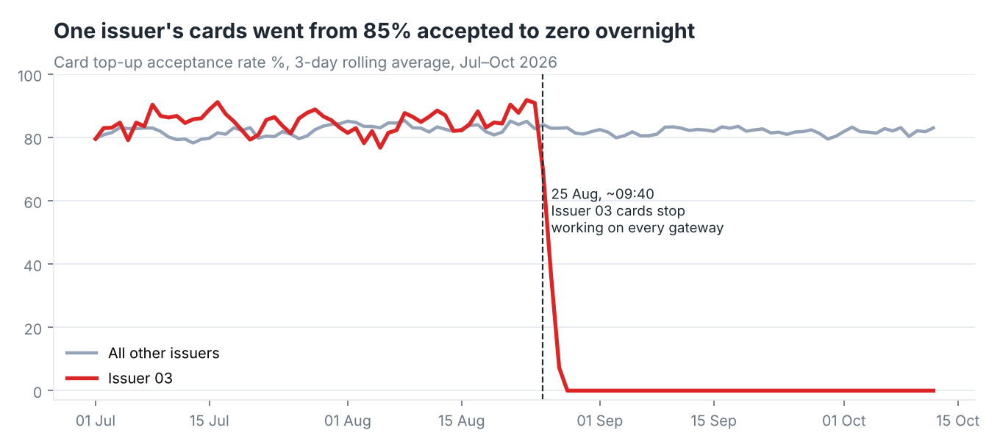
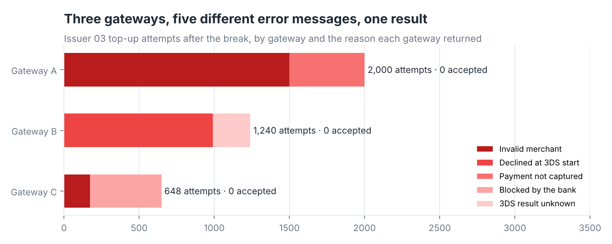

# Card Top-up Failure Investigation (SQL case study)

**Tools:** SQL (BigQuery): CTEs, window functions, `QUALIFY`, conditional aggregation, self-joins
**Data:** 30.6K card top-up attempts from 9,000 wallet accounts, 8 card issuers, 3 payment gateways · 1 Jul – 12 Oct 2026
**Note:** Synthetic data. At work I built a report on a real top-up problem with one bank's cards. This repo replays that kind of investigation on generated data for a fictional wallet, "Northwind Pay". Issuers and gateways are anonymised ("Issuer 03", "Gateway A").

---

## The question

Support tickets said "my card top-up keeps failing". Each gateway's dashboard looked normal, and each gateway blamed something different: "invalid merchant", "declined at 3DS start", "blocked by the bank". The questions were:
- Is something actually broken?
- Since when?
- Whose problem is it?
- What is it costing?

I answered them in four steps, one SQL file each.

## Step 1 · Clean the data ([`sql/01_clean.sql`](sql/01_clean.sql))

The gateway webhook sometimes sent the same attempt twice, and 3% of attempts had no card currency. I built one view, `v_attempts`, that:
- **deduplicates** with `QUALIFY ROW_NUMBER() OVER (PARTITION BY attempt_id …) = 1`, which removed 120 rows
- labels a missing currency as "Not given" instead of dropping the row
- adds amount bands and the account's age at the time of the attempt
- numbers each customer's attempts within the day

## Step 2 · Find the problem ([`sql/02_find_the_problem.sql`](sql/02_find_the_problem.sql))

| Issuer | Acceptance 1 Jul – 24 Aug | Acceptance 25 Aug – 12 Oct |
|---|---|---|
| **Issuer 03** | **85.0%** | **0.3%** |
| Issuer 01 | 86.2% | 86.2% |
| Issuer 02 | 83.7% | 84.6% |
| … 5 others | 78–81% | 74–82% |

Issuer 03 cards were accepted as often as everyone else's until **25 August**, then stopped completely. The last accepted Issuer 03 top-up was at **08:43**. Every attempt from **10:30** onwards failed. Every other issuer was unaffected.



## Step 3 · Rule out the usual suspects ([`sql/03_rule_out_causes.sql`](sql/03_rule_out_causes.sql))

| Suspect | Test | Result |
|---|---|---|
| A gateway is down | Acceptance by gateway, Issuer 03 only | **0 of 3,888** accepted on **all three** gateways |
| …but the gateways work | The same gateways with other issuers' cards | 81.6–82.7% accepted, normal |
| Large amounts hitting a limit | Acceptance by amount band | 0% in **every** band, including top-ups under $20 |
| One card currency or brand | USD vs LBP, Visa vs Mastercard | 0% everywhere |
| New or suspicious accounts | Accounts 30 days old or newer vs older | 0% for both, and 97% of attempts came from older accounts |

Each gateway described the failure differently. Gateway A said "invalid merchant", Gateway B said "declined at 3DS start", Gateway C said "blocked by the bank". The result was the same everywhere. **One issuer, every gateway, every amount, every currency points to the issuer.** The likely cause is a block on the issuer's side for our merchant category, or a change to its 3-D Secure setup that day. Opening tickets with the three gateways would not fix it.



## Step 4 · Size the impact ([`sql/04_customer_impact.sql`](sql/04_customer_impact.sql))

- **831 customers** were affected, with **3,888 failed attempts** between them, an average of **4.7 attempts** per customer. 578 customers tried 3 or more times, and one tried 24 times.
- After a failure, only **7.4%** of customer-days ended with a successful top-up on another card that day. In the other **92.6%**, the customer didn't manage to top up by card that day.
- Customers tried to load **$231K**, counting each customer-day once at its largest attempt so retries aren't double counted. That is about **$4.8K a day** not coming in. At a 1.5% top-up fee, it's **$3.5K** of fee revenue so far, before counting customers who stop using the wallet.

## What I recommended

1. **Escalate to Issuer 03, not the gateways.** Send them the evidence in [`ESCALATION_NOTE.md`](ESCALATION_NOTE.md): the start time, 0 of 3,888 accepted, and normal results for other issuers on the same gateways.
2. **Tell affected customers in the app now.** When someone with an Issuer 03 card tries to top up, show a message pointing to other cards or cash top-up at an agent. That stops the 4–24 retries per person.
3. **Add a daily check** that compares each issuer's acceptance with its own 30-day average. The query in `02_find_the_problem.sql` already does most of it. With that check, this problem would have been flagged on the morning of 25 August instead of being found weeks later through tickets.

## Files

```
data/                topup_attempts.csv (raw, with duplicates), accounts.csv
sql/01_clean.sql     dedupe + derived fields -> view v_attempts
sql/02_…             is it broken, since when
sql/03_…             rule out gateway, amount, currency, brand, account age
sql/04_…             customers, behaviour after failure, money at risk
ESCALATION_NOTE.md   the one-page note sent to the issuer / management
BUILD_GUIDE.md       how to load into BigQuery and run it yourself
```
