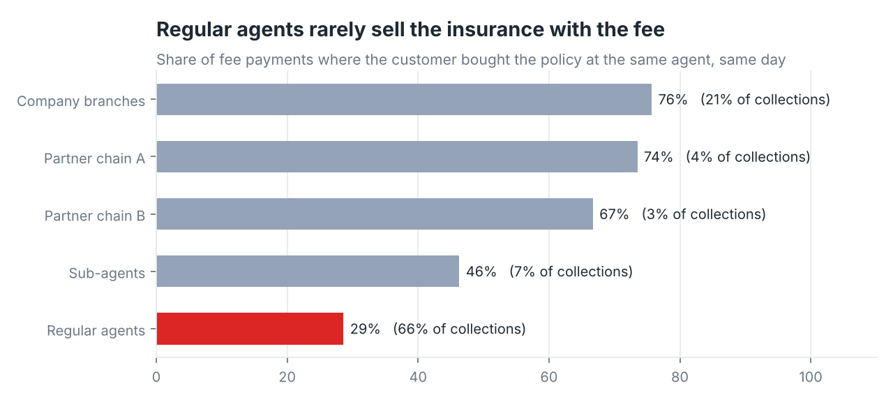
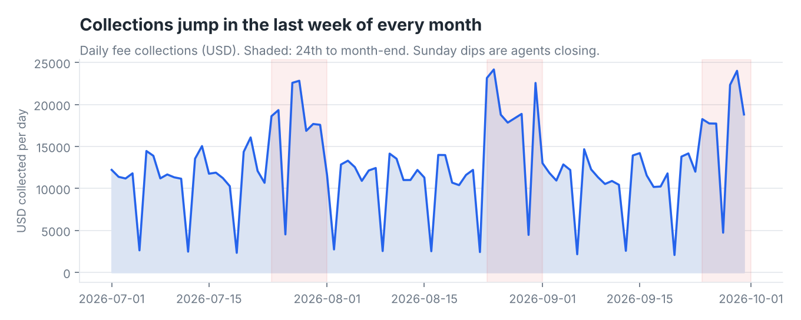

# Agent-Network Collections Pipeline

**Tools:** Google Sheets · Google Apps Script (JavaScript) · Looker Studio
**Data:** 30.7K fee payments and 13.1K insurance policy sales across 860 retail agents · Jul–Sep 2026
**Note:** Synthetic data. At work I built pipelines like this one in Google Sheets and Apps Script for payments collected through a retail agent network. This repo rebuilds one on generated data for a fictional wallet, "Northwind Pay". Agents, insurers and amounts are all made up.

---

## The problem

Every month the agent system sends a raw export of fee payments, and the partner insurers send a list of the policies our agents sold. Both files were messy:
- dates in `dd/mm/yyyy`, which Sheets silently turns into the wrong date if the file's locale is US
- amounts in Lebanese pounds stored as text with commas (`"3,132,500"`)
- the four insurers spelled a dozen different ways
- rows repeated whenever an agent's terminal re-synced
- policy numbers like `0`, `N/A` or `123`

Building the monthly report by hand took most of a day, and the numbers changed depending on who built it.

## What I built

A small data pipeline that lives inside one Google Sheet, with Looker Studio on top:

```
RAW_PAYMENTS ─┐                                ┌─> MART_DAILY  (date × network × insurer)
              ├─> Apps Script runLoad() ─> FCT ┤
RAW_POLICY_SALES ┘   parse · clean · check  ·   └─> DIM_AGENT   (one row per agent, rank, tier)
                     de-duplicate · link             │
                     │                               └─> Looker Studio dashboard
                     ├─> DQ_LOG   (every row that failed a check, and why)
                     └─> LOAD_LOG (one row per run: counts, days replaced, duration)
```

- **One click.** A custom menu runs **Pipeline → Load raw sheets**.
- **Safe to re-run.** Loading the same month twice *replaces* those days instead of doubling them. The local test proves this.
- **Data-quality checks on every row:**

  | Flag | Rows |
  |---|---|
  | Placeholder policy number | 304 |
  | Policy term outside 330–400 days | 326 |
  | Insurer missing | 86 |
  | Policy details missing | 67 |

  Flagged rows stay in the totals but are marked `review`, so the dashboard can show "97.4% of payments passed checks".
- **Linking two sources.** Each payment is matched to the policy-sales file on policy number. That shows whether the customer bought the insurance at the same agent on the same day, which is the cross-sell metric the business cared about.
- **Tested.** [`tests/run_pipeline_test.js`](tests/run_pipeline_test.js) runs the exact `Code.gs` in Node against a mock of Google Sheets. It loads three months, re-loads one, and checks 9 rules, including no duplicates, day-first dates and impossible dates rejected.

## What the data showed

| Metric (Jul–Sep 2026) | Value |
|---|---|
| Fees collected | **$1,157,605** from 30,659 payments |
| Active agents | 860 |
| Average payment | $37.76 |
| Payments per day | 333 on average |
| Policies sold by our agents | 13,079 ($549K premium) |

**1. The biggest opportunity is cross-selling at regular agents.**
At company branches, **76%** of customers who pay the fee also buy their insurance there the same day. At regular agents it's **29%**, and regular agents handle **66%** of all collections. If regular agents only matched sub-agents (46%), that would be about **3,560 more policies** a quarter, roughly **$24K** in commission at an assumed 16% share of premium. Matching branches would be about $64K.



**2. Collections are concentrated, and they peak at month-end.**
- The top **50 agents** (6% of the network) bring in **36.7%** of collections, and **102 agents** bring in half.
- Daily collections average **$17.9K** from the 24th to month-end, against **$10.8K** the rest of the month.
- Mondays and Tuesdays are the busiest weekdays.

This tells agents' cash and float planning when to expect a rush.



**3. Data problems come from a few places.**
**8 agents**, about 1% of the network, produced **31%** of all placeholder policy numbers. A 10-minute call with those 8 fixes a third of the problem.

## What I'd recommend
- A cross-sell push at the top 100 regular agents: a script for the counter, and a weekly leaderboard built from `DIM_AGENT.same_day_policy_rate`.
- Remind agents to top up their float before the 24th of each month.
- Contact the 8 agents behind most of the placeholder policies. Watch `DQ_LOG` weekly.

## Repo contents

```
apps_script/Code.gs          the pipeline (paste into Extensions → Apps Script)
data/raw/                    monthly raw exports: payments_YYYY-MM.csv, policy_sales_YYYY-MM.csv
data/seed/                   CONFIG and DIM_INSURER (insurer spelling → clean name)
tests/run_pipeline_test.js   runs Code.gs locally against a Sheets mock; writes tests/output/*.csv
tests/output/                what each output sheet should look like after loading Jul–Sep
scripts/                     data generator, analysis + charts
BUILD_GUIDE.md               set it up in your own Google Sheet + build the Looker Studio report
```
