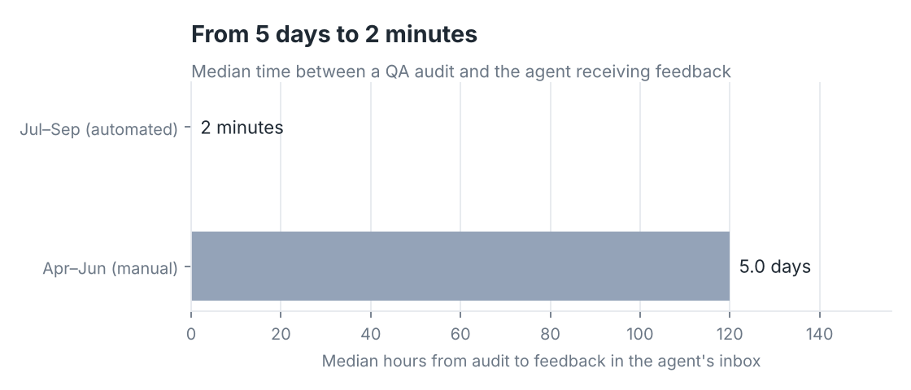
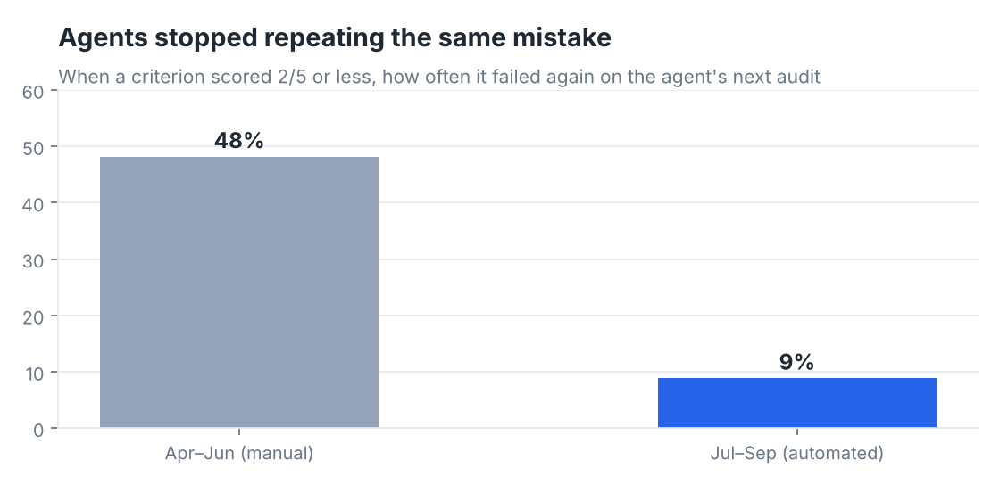
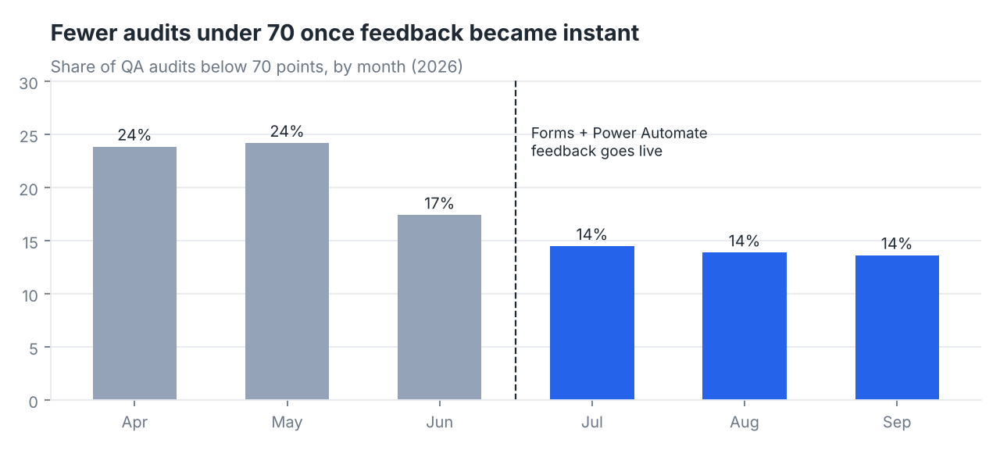

# QA Scorecard Automation: from spreadsheet tabs to same-day feedback

**Tools:** Microsoft Forms · Power Automate · Excel (tables, formulas) · Power BI · optional Power Apps
**Data:** 1,572 QA audits of 40 support agents across calls, tickets and chats · Apr–Sep 2026
**Note:** Synthetic data. I worked in quality assurance for an after-sales support team and built the QA tracking sheets and audit dashboard. This repo rebuilds the scoring rubric and adds the automation on generated data for a fictional wallet, "Northwind Pay". The agent names are invented.

---

## The problem

QA reviewers scored each call or ticket in a spreadsheet, one tab per agent. Once a week someone copied the results into emails. That caused three problems:
- Agents heard about a mistake **about 5 days** after making it, by which time they had often repeated it.
- Nobody tracked whether feedback was read.
- Managers couldn't see trends across agents or criteria without rebuilding the sheet.

## What I built

1. **A weighted rubric** with six criteria scored 0–5. The weights add up to 100. A failed identity check before an account change is a **critical error** and caps the audit at 59, whatever the other scores.

   | Criterion | Weight |
   |---|---|
   | Communication | 15 |
   | Issue handling & SOP | 25 |
   | Resolution & follow-up | 20 |
   | Escalation & ownership | 15 |
   | Accuracy & documentation | 10 |
   | Security & compliance | 15 |

   Bands: **90+ Outstanding · 80–89 Solid Performance · 70–79 Meets Expectations · 60–69 Needs Improvement · under 60 Critical**.
2. **An Excel audit log** ([`templates/QA_Audit_Log_TEMPLATE.xlsx`](templates/QA_Audit_Log_TEMPLATE.xlsx)).
   - `score`, `band` and `hours_to_feedback` are formula columns. Change a weight on the Rubric sheet and every score updates.
   - The Agents sheet rolls up audits, average score, audits under 70 and critical errors per agent.
3. **Two Power Automate flows** ([`FLOW_SPEC.md`](FLOW_SPEC.md)).
   - **Flow 1, on every audit:**
     - The reviewer submits a Microsoft Form, and the flow logs the audit in Excel.
     - The flow reads back the calculated score.
     - If the audit is under 70 or has a critical error, the team lead gets an email and the agent gets an **email with buttons**: *Acknowledge* or *I'd like to discuss*.
     - The agent's click is written back to the log, and "discuss" pings the reviewer on Teams.
   - **Flow 2, every Monday at 08:00:** a summary email to the QA manager with every audit under 70 from the past week.
4. **A Power BI report** on the log, built as described in [`BUILD_GUIDE.md`](BUILD_GUIDE.md):
   - overview
   - agent scorecards
   - an agent × criterion heatmap
   - a before/after automation page

## What changed after the switch (1 July)

| | Apr–Jun (manual) | Jul–Sep (automated) |
|---|---|---|
| Median time from audit to feedback | **5 days** | **2 minutes** |
| Median time for the agent to acknowledge | 22 hours | 3.6 hours |
| Audits scoring under 70 | 21.8% | 14.0% |
| Average audit score | 76.2 | 80.0 |
| Same criterion failed again on the next audit | **48%** | **9%** |



The clearest effect is on **repeat mistakes**. Before, when an agent scored 2/5 or less on a criterion, they failed it again on their next audit 48% of the time. Afterwards it was 9%. Feedback that arrives while the call is still fresh gets acted on.



The share of weak audits also fell, though scores were already starting to improve in June. With no control group, I describe this as "what changed after the switch", not as proof that automation caused all of it.



**Where agents struggle most:** *Issue handling & SOP* (144 audits at 2/5 or below) and *Security & compliance* (132). The second matters most, because each of the **66 critical errors** was an account change made before the customer's identity was checked. That pointed to a refresher session on the verification SOP, which the dashboard lets you target to specific agents.

## Repo contents

```
data/audits.csv, agents.csv, rubric.csv, score_bands.csv   synthetic audit data
data/QA_Audit_Log_SAMPLE.xlsx                              the Excel log filled with 6 months of audits (formulas recalculated)
templates/QA_Audit_Log_TEMPLATE.xlsx                       empty log for the flow: upload to OneDrive
FLOW_SPEC.md                                               the Form, both flows step by step, expressions, email template
BUILD_GUIDE.md                                             set it up end to end + the Power BI report
scripts/                                                   data generator, workbook builder, analysis + charts
```
