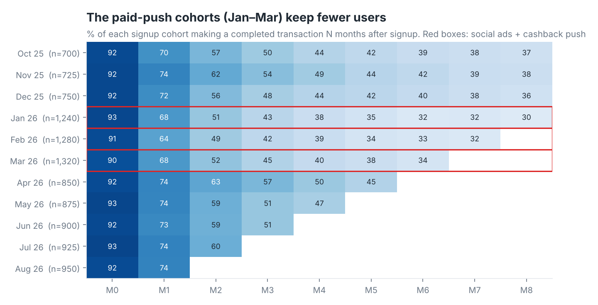
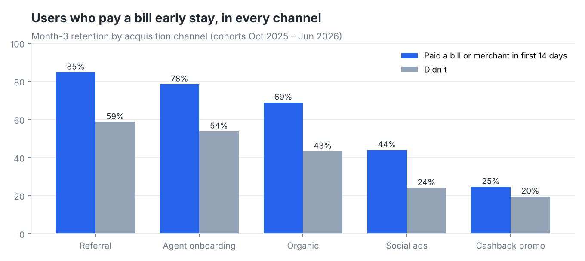
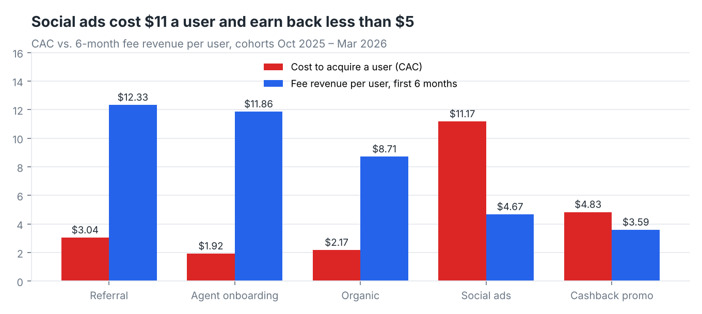

# Digital Wallet Retention & Cohorts: which users stay, and which channels pay back?

**Tools:** SQL (BigQuery): cohorts, window functions, `NTILE`, CTEs · Power BI (cohort heatmap, DAX)
**Data:** 10.5K users, 209K transactions, monthly marketing spend · signups Oct 2025 – Aug 2026
**Note:** Personal project on synthetic data. The scenario is realistic for the fintech I work in, but the company ("Northwind Pay"), users and figures are generated. The generator script is included, so the data is fully transparent.

---

## The question

In January–March 2026 Northwind Pay ran its biggest growth push: social ads plus a cashback promo. Signups jumped about 60%. Three months later, leadership asked:
1. Did those users **stay**?
2. What separates users who stay from users who leave?
3. Which acquisition channels **pay back** what they cost?
4. Who should we talk to *now*?

## Approach

| Step | SQL file | Technique |
|---|---|---|
| Base tables: one row per user, and one row per user per active month | [`01_base_tables.sql`](sql/01_base_tables.sql) | `DATE_TRUNC`, `DATE_DIFF(…, MONTH)`, `LOGICAL_OR` for "activated in the first 14 days" |
| Cohort retention triangle | [`02_cohort_retention.sql`](sql/02_cohort_retention.sql) | long → wide pivot with `MAX(IF(month_number = n, …))` |
| Retention by channel and by early behaviour | [`03_channels_and_activation.sql`](sql/03_channels_and_activation.sql) | the activation effect checked *within* each channel, so channel mix can't explain it |
| Payback: CAC vs 6-month revenue | [`04_payback_by_channel.sql`](sql/04_payback_by_channel.sql) | joins spend to users and keeps only revenue from each user's first 6 months |
| Who to contact now | [`05_rfm_segments.sql`](sql/05_rfm_segments.sql) | RFM scores with `NTILE(5) OVER (…)`, mapped to segments |

Definitions:
- **Active** in a month means at least one completed transaction.
- **Month-3 retention** is only measured for cohorts with 3 full months of data.
- **Activated** means paying a bill or a merchant within 14 days of signing up.

## Findings

**1. The growth-push cohorts kept fewer users.**
The January–March cohorts retained **42–45%** of users at month 3. Every other cohort retained **48–57%**. Signups went up, but a smaller share of them stayed.



**2. Channel matters, and the paid channels are the weakest.**

| Channel | Month-3 retention | Activated in 14 days |
|---|---|---|
| Referral | **66%** | 41% |
| Agent onboarding | **63%** | 50% |
| Organic | 48% | 32% |
| Social ads | **23%** | 14% |
| Cashback promo | **20%** | 10% |

**3. Paying a bill or a merchant in the first 14 days is the strongest early signal.**
- Activated users retain at **73%** by month 3, against **41%** for everyone else, which is 1.8 times higher.
- The gap appears **inside every channel**: Referral 85% vs 59%, Organic 69% vs 43%, Social ads 44% vs 24%.

So it isn't just that good channels bring good users. The habit itself matters. (This is an association, not proof of cause. The next step would be an A/B test of an onboarding nudge.)



**4. Two channels lose money.**
For cohorts with 6 full months of data:
- **Social ads** cost **$11.17** per user and earned **$4.67** in fees: a loss of $6.49 per user, returning $0.42 for every $1 spent.
- **Cashback promo** returned $0.74 per $1.
- **Agent onboarding** returned **$6.17 per $1**, and **Referral** returned **$4.05 per $1**.



**5. Who to talk to now** (RFM, users active since April 2026)
- **Champions** are 22% of users and bring in **44%** of fee revenue.
- **1,061 "at risk" users** used to transact often but have been quiet for about 74 days on average. They still account for 14% of revenue, which makes them the cheapest win-back list.

## Recommendations
1. **Move budget from social ads to referral and agent onboarding.** At current numbers, every $1,000 moved from social ads to referral returns about $4,050 in 6-month fees instead of $420.
2. **Make "pay your first bill" the onboarding goal.** Use an in-app checklist and a small first-bill reward instead of a top-up cashback, which attracts one-time users. Test it with an A/B test on new signups.
3. **Run a win-back campaign** for the at-risk segment: a personal message plus a bill-pay reminder. Send it before they slip into the "slipping away" group.

## Files
```
data/          users.csv, transactions.csv.zip (unzip first), marketing_spend.csv (synthetic)
sql/           01–05 as above (BigQuery Standard SQL)
scripts/       generate_data.py (how the data was made), make_charts.py
BUILD_GUIDE.md run it in BigQuery + build the Power BI report
```
